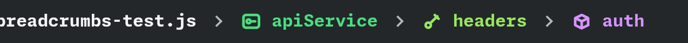

# Acode Breadcrumbs

<p align="center">
  
</p>

<p align="center">
  <a href="https://github.com/CodeNoKami/acode-breadcrumbs/blob/main/LICENSE">
    
  </a>
  <a href="https://github.com/CodeNoKami/acode-breadcrumbs/releases">
    
  </a>
  
</p>

---

<!-- Description Card (HTML/CSS Styled Container) -->
<div style="background-color: #161b22; border-left: 4px solid #b39ddb; padding: 15px; border-radius: 6px; margin: 20px 0;">
  <p style="line-height: 1.6; font-size: 15px; color: #c9d1d9; margin: 0;">
    A high-performance, theme-adaptive, desktop-grade <strong style="color: #b39ddb;">VS Code-style Breadcrumbs Navigation Bar</strong> engineered specifically for the Acode Editor. 
    This plugin brings deep architectural visibility and fluid source code navigation to mobile viewports. Powered by a lightweight, real-time <strong style="color: #b39ddb;">Lezer AST Parsing Engine</strong>, it dynamically maps structural syntax definitions into an interactive hierarchy directly above your active viewport.
  </p>
</div>

---

## 📸 <span style="color: #10b981;">Scope Previews</span>

<table width="100%">
  <tr>
    <td width="50%" align="center"><b>🛡️ Try-Catch-Finally Enclosures</b></td>
    <td width="50%" align="center"><b>🗂️ Property & Method Chains</b></td>
  </tr>
  <tr>
    <td>
      <kbd>
        
      </kbd>
    </td>
    <td>
      <kbd>
        
      </kbd>
    </td>
  </tr>
  <tr>
    <td colspan="2" align="center">
      <i>Real-time structural rendering matching cleanly from active files to deeply nested logical scopes.</i>
    </td>
  </tr>
</table>

## 📸 <span style="color: #10b981;">Fullscreen Popup Previews</span>

<!-- Full Size Multi-Theme Previews Block -->
<div style="background-color: #0d1117; border: 1px solid #30363d; border-radius: 8px; padding: 16px; margin: 16px 0;">
  
  <table width="100%" style="border-collapse: collapse; border: none;">
    <tr>
      <td width="50%" align="center" style="border: none; padding: 8px;">
        <b style="color: #c9d1d9; display: block; margin-bottom: 8px;">🌌 Popup Dark Mode Preview</b>
        <kbd style="display: block; border: 1px solid #21262d; padding: 4px; background-color: #161b22; border-radius: 8px;">
          
        </kbd>
      </td>
      <td width="50%" align="center" style="border: none; padding: 8px;">
        <b style="color: #c9d1d9; display: block; margin-bottom: 8px;">☀️ Popup Light Mode Preview</b>
        <kbd style="display: block; border: 1px solid #21262d; padding: 4px; background-color: #161b22; border-radius: 8px;">
          
        </kbd>
      </td>
    </tr>
    <tr>
      <td colspan="2" align="center" style="border: none; padding-top: 12px;">
        <i style="color: #8b949e; font-size: 13px;">Real-time structural rendering matching cleanly from active files to deeply nested logical scopes across different canvas luminance.</i>
      </td>
    </tr>
  </table>

</div>

### ⚡ <span style="color: #34d399;">Flawless Nested Scope Tracking & Dynamic Methods `[v2.6.0]`</span>

Real-time structural rendering mapping cleanly from the active filename through classes, methods, context blocks, and loops:

```
database.ts › 🔶 DatabaseService › 📦 constructor › 🔄 while
userController.js › 🍇 usersList.filter › 🔶 if
app.tsx › 🔄 iifeModule › 🛡️ try
```

### 💎 <span style="color: #34d399;">TypeScript Type & Data Awareness</span>

Clean UI feedback for advanced TS constraints, Type interfaces, array lists, and variable scopes:

```
types.ts › 📄 UserRole › 🟢 config_list › 🗂️ properties
```

---

## ✨ <span style="color: #10b981;">Features</span>

<!-- Main Card Wrapper -->
<div style="background-color: #0d1117; border: 1px solid #30363d; border-radius: 8px; padding: 20px; margin: 16px 0;">
  
  <!-- Card Header -->
  <div style="border-bottom: 1px solid #21262d; padding-bottom: 12px; margin-bottom: 16px;">
    <h3 style="margin: 0; color: #10b981; font-size: 18px; display: flex; align-items: center; gap: 8px;">
      🚀 Key Capabilities & Core Features
    </h3>
  </div>

  <!-- Box 1 -->
  <div style="background-color: #161b22; border: 1px solid #30363d; border-radius: 6px; padding: 14px; margin-bottom: 12px;">
    <p style="margin: 0; line-height: 1.5; color: #c9d1d9;">
      <strong style="color: #34d399;">🗂️ VS Code-Parity Path Mapping:</strong> Anchors the active filename as the structural root node before drilling down into the file architecture (<code>Filename › Scope › Sub-Scope</code>), matching standard desktop IDE layouts.
    </p>
  </div>

  <!-- Box 2 -->
  <div style="background-color: #161b22; border: 1px solid #30363d; border-radius: 6px; padding: 14px; margin-bottom: 12px;">
    <p style="margin: 0; line-height: 1.5; color: #c9d1d9;">
      <strong style="color: #34d399;">🎯 Interactive Offset Navigation:</strong> Every segment rendered on the breadcrumbs bar is a fully clickable target. Tap any scope to instantly jump the editor cursor to the corresponding code block offset and focus the viewport.
    </p>
  </div>

  <!-- Box 3 -->
  <div style="background-color: #161b22; border: 1px solid #30363d; border-radius: 6px; padding: 14px; margin-bottom: 12px;">
    <p style="margin: 0; line-height: 1.5; color: #c9d1d9;">
      <strong style="color: #34d399;">🔄 Balanced Scope Aggregation Engine <code>[v2.6.0]</code>:</strong> Intelligently balances syntax accuracy with UX sanity. Traverses the AST tree to expose nested loops, conditionals, and error handling without cluttering the screen or overwhelming your mobile viewport layout.
    </p>
  </div>

  <!-- Box 4 -->
  <div style="background-color: #161b22; border: 1px solid #30363d; border-radius: 6px; padding: 14px; margin-bottom: 12px;">
    <p style="margin: 0; line-height: 1.5; color: #c9d1d9;">
      <strong style="color: #34d399;">🎨 15-Node High-Contrast Palette Configurator <code>[v2.6.0]</code>:</strong> Offers individual Hex text inputs in the settings dashboard for all 15 supported semantic layout structures (including newly added Control Flow blocks).
    </p>
  </div>

  <!-- Box 5 -->
  <div style="background-color: #161b22; border: 1px solid #30363d; border-radius: 6px; padding: 14px; margin-bottom: 12px;">
    <p style="margin: 0; line-height: 1.5; color: #c9d1d9;">
      <strong style="color: #34d399;">🔍 Luminance-Aware Theme Adaptivity:</strong> Automatically reads the active editor canvas background luminance. It hooks into computed variables to map syntax colors dynamically to custom Light (GitHub-Light inspired) or Matte Dark (One-Dark/Dracula hybrid) standards seamlessly.
    </p>
  </div>

  <!-- Box 6 -->
  <div style="background-color: #161b22; border: 1px solid #30363d; border-radius: 6px; padding: 14px;">
    <p style="margin: 0; line-height: 1.5; color: #c9d1d9;">
      <strong style="color: #34d399;">✨ Acrylic Frosted Glass Overlay:</strong> Employs a hardware-accelerated backdrop blur filter underneath long-press structural code previews for an immersive visual experience.
    </p>
  </div>

</div>

---

## 🎨 <span style="color: #10b981;">Scope Syntax & Theme Mapping</span>

All vector icons are rendered via optimized 16x16 viewport inline SVGs with standard-compliant line weight balancing.

| Token Scope Type           | Vector Concept | Default Palette | Node Type / Abstract Mapping Context                      |
| :------------------------- | :------------: | :-------------: | :-------------------------------------------------------- |
| **class**                  |       🔲       |    `#FFB834`    | Object-Oriented Blueprint classes & declarations          |
| **interface**              |  🔲 (Dashed)   |    `#46D9FF`    | TypeScript Structural Model Contracts                     |
| **type**                   |       📄       |    `#10E5FA`    | Type Aliases, Union, and Intersection specs               |
| **enum**                   |       📄       |    `#00F5D4`    | Numeric / String Enumeration definitions                  |
| **method**                 |       📦       |    `#D694FF`    | Inside Class Functions & Object Constructors              |
| **function**               |      _𝑓_       |    `#60A5FA`    | Global lexical declarations & functional scopes           |
| **arrow**                  |       🏹       |    `#34D399`    | Lambda Callbacks, Inline Promises & Anonymous expressions |
| **property**               |       🗂️       |    `#99E65F`    | Explicit Key/Value mappings inside JSON or literals       |
| **object**                 |       📦       |    `#6EE7B7`    | Instantiated structural JSON Objects & configurations     |
| **array**                  |       📊       |    `#FCD34D`    | Iterable Array brackets & assignment signatures           |
| **variable**               |       🟢       |    `#4ADE80`    | Local mutable/immutable blocks (let, const, var)          |
| **jsx**                    |       ⚛️       |    `#22D3EE`    | React Components, XML Fragment tags & layout blocks       |
| **conditional** `[v2.6.0]` |       🔶       |    `#d68600`    | Flowchart Decision Nodes (if, else, switch)               |
| **looping** `[v2.6.0]`     |       🔄       |    `#52ff72`    | Cyclic Iteration Nodes (for, while, do-while)             |
| **tcf** `[v2.6.0]`         |       🛡️       |    `#fa3b49`    | Defensive Exception Enclosures (try, catch, finally)      |

---

## 🛠️ <span style="color: #10b981;">Contributor & Architecture Extension Guide</span>

The plugin evaluates structural trees into a single visual state array using a decoupled architectural workflow:

```
[CodeMirror Viewport Change]
│
▼
[lezerParser.ts] ──► Decodes Raw Lezer Tree via Nodes Range
│
▼
[ScopeType Evaluation]
│
▼
[patterns.ts]  ──► Matches Scope Type to Vector Path + Color Token
│
▼
[DOM Representation] (Breadcrumb Bar Updates)
```

<details>
  <summary>📦 Click to view Project Anatomy Details</summary>

<br>

### 🟢 <span style="color: #34d399;">Project Components</span>

- `main.ts`: Orchestrates workspace layout injections, window touch event bindings, long-press gestures, preference caching, and DOM updates.
- `lezerParser.ts`: Evaluates active syntax trees. Contains specific language rules determining if an active tree offset falls under structural declaration categories or helper blocks.
- `patterns.ts`: Defines the UI/UX components. Holds type structures, default premium styling dictionaries, and custom SVG paths.
</details>

### 🟢 <span style="color: #34d399;">Adding New Language Tokens</span>

To register and implement a new syntax block mapping (e.g., adding a database query tag or markdown scope):

1. **Extend the Type Base:** Open `patterns.ts` and append your target key string identifier into the `ScopeType` union:

```typescript
export type ScopeType = "class" | "function" | "yourNewToken";
```

2.  **Assign Core Identity Colors:** Update the fallback color configuration map (DEFAULT_BREADCRUMBS_COLORS):

```typescript
export const DEFAULT_BREADCRUMBS_COLORS: Record<string, string> = {
  yourNewToken: "#FF5555", // Modern Red Accent
};
```

3.  **Draft the UI Vector Path:** In getIconByType(), append a case block defining your custom vector inside the 16x16 frame setup:

```typescript
case "yourNewToken":
  return `<svg ${svgStyle}><path d="M2 2h12v12H2z"/></svg>`;


```

4.  **Hook Into the Parsing Stream:** Update lezerParser.ts to identify the syntax tag name delivered by the underlying language package dialect.

## 📦 <span style="color: #10b981;">Compilation & Build Pipeline</span>

Ensure you have **Node.js** installed inside your development setup.

```bash
# 1. Clone the Repository
git clone [https://github.com/CodeNoKami/acode-breadcrumbs.git](https://github.com/CodeNoKami/acode-breadcrumbs.git)
cd acode-breadcrumbs

# 2. Initialize Dependencies
npm install

# 3. Execute Production Bundling
npm run build


```

> 💡 **Deployment Note:** The pipeline leverages Esbuild to resolve TypeScript modules, outputting a lightweight production ZIP archive to your root workspace folder. Import this package directly into Acode's local plugin manager.

## 📄 <span style="color: #10b981;">Core Technical Stack</span>

- **Engine Target:** TypeScript 5.x+ Execution Core
- **Parsing Backend:** CodeMirror 6 Lezer Syntactic Traversal Tree
- **Platform Target:** Acode Mobile Extensibility Ecosystem
- **License Model:** Open-source MIT Certification Rules.
<p align="center">Created with 💻 by <b style="color: #b39ddb;">CodeNoKami</b></p>
