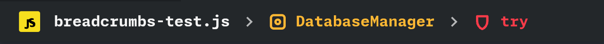
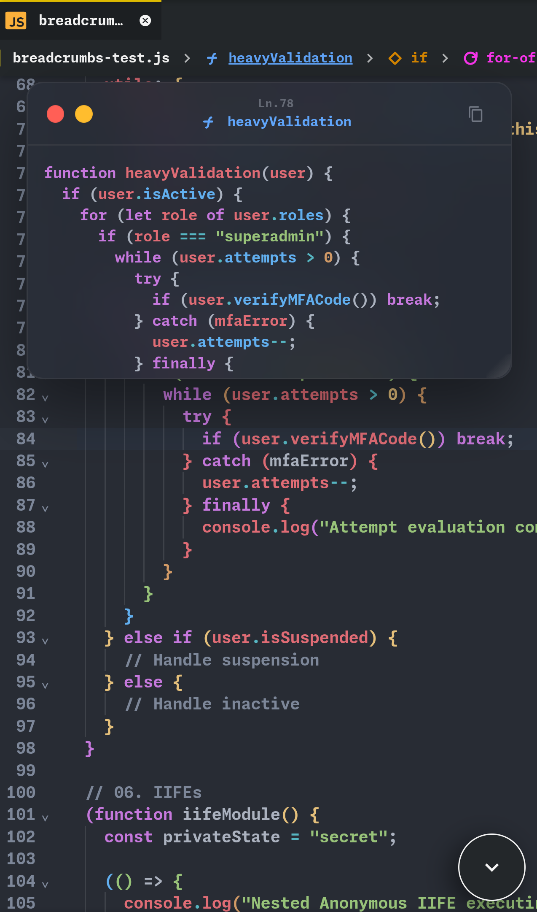
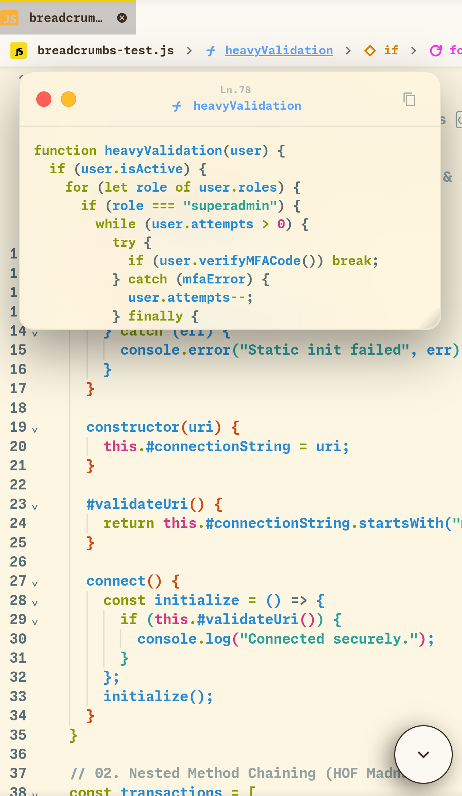

<p align="center">
  
</p>

<p align="center">
  <a href="https://github.com/CodeNoKami/acode-breadcrumbs/blob/main/LICENSE">
    
  </a>
  <a href="https://github.com/CodeNoKami/acode-breadcrumbs/releases">
    
  </a>
  
</p>

---

<!-- Description Card (HTML/CSS Styled Container) -->
<div style="background-color: #161b22; border-left: 4px solid #b39ddb; padding: 15px; border-radius: 6px; margin: 20px 0;">
  <p style="line-height: 1.6; font-size: 15px; color: #c9d1d9; margin: 0;">
    A high-performance, theme-adaptive, desktop-grade <strong style="color: #b39ddb;">VS Code-style Breadcrumbs Navigation Bar</strong> engineered specifically for the Acode Editor. 
    This plugin brings deep architectural visibility and fluid source code navigation to mobile viewports. Powered by a lightweight, real-time <strong style="color: #b39ddb;">Lezer AST Parsing Engine</strong>, it dynamically maps structural syntax definitions into an interactive hierarchy directly above your active viewport.
  </p>
</div>

---

## 📸 <span style="color: #10b981;">Scope Previews</span>

<table width="100%">
  <tr>
    <td width="50%" align="center"><b>🛡️ Try-Catch-Finally Enclosures</b></td>
    <td width="50%" align="center"><b>🗂️ Property & Method Chains</b></td>
  </tr>
  <tr>
    <td>
      <kbd>
        
      </kbd>
    </td>
    <td>
      <kbd>
        
      </kbd>
    </td>
  </tr>
  <tr>
    <td colspan="2" align="center">
      <i>Real-time structural rendering matching cleanly from active files to deeply nested logical scopes.</i>
    </td>
  </tr>
</table>

## 📸 <span style="color: #10b981;">Fullscreen Popup Previews</span>

<!-- Full Size Multi-Theme Previews Block -->
<div style="background-color: transparent; padding: 16px; margin: 16px 0;">
  
  <table width="100%" style="border-collapse: collapse; border: none;">
    <tr>
      <td width="50%" align="center" style="border: none; padding: 8px;">
        <b style="display: block; margin-bottom: 8px;">🌌 Popup Dark Mode Preview</b>
        <kbd style="display: block; border: 1px solid #21262d; padding: 4px; background-color: #161b22; border-radius: 8px;">
          
        </kbd>
      </td>
      <td width="50%" align="center" style="border: none; padding: 8px;">
        <b style=" display: block; margin-bottom: 8px;">☀️ Popup Light Mode Preview</b>
        <kbd style="display: block; border: 1px solid #21262d; padding: 4px; background-color: #161b22; border-radius: 8px;">
          
        </kbd>
      </td>
    </tr>
    <tr>
      <td colspan="2" align="center" style="border: none; padding-top: 12px;">
        <i style="color: #8b949e; font-size: 13px;">Real-time structural rendering matching cleanly from active files to deeply nested logical scopes across different canvas luminance.</i>
      </td>
    </tr>
  </table>

</div>

### ⚡ <span style="color: #34d399;">Flawless Nested Scope Tracking & Dynamic Methods `[v2.6.0]`</span>

Real-time structural rendering mapping cleanly from the active filename through classes, methods, context blocks, and loops:

```

database.ts › 🔶 DatabaseService › 📦 constructor › 🔄 while
userController.js › 🍇 usersList.filter › 🔶 if
app.tsx › 🔄 iifeModule › 🛡️ try
```

### 💎 <span style="color: #34d399;">TypeScript Type & Data Awareness</span>

Clean UI feedback for advanced TS constraints, Type interfaces, array lists, and variable scopes:

```
types.ts › 📄 UserRole › 🟢 config_list › 🗂️ properties
```

---

## ✨ <span style="color: #10b981;">Features</span>

<!-- Main Card Wrapper -->
<div style="background-color: transparent;  border-radius: 8px; padding: 20px; margin: 16px 0;">
  
  <!-- Card Header -->
  <div style="border-bottom: 1px solid #21262d; padding-bottom: 12px; margin-bottom: 16px;">
    <h3 style="margin: 0; color: #10b981; font-size: 18px; display: flex; align-items: center; gap: 8px;">
      🚀 Key Capabilities & Core Features
    </h3>
  </div>

  <!-- Box 1 -->
  <div style="background-color: #161b22; border: 1px solid #30363d; border-radius: 6px; padding: 14px; margin-bottom: 12px;">
    <p style="margin: 0; line-height: 1.5; color: #c9d1d9;">
      <strong style="color: #34d399;">🗂️ VS Code-Parity Path Mapping:</strong> Anchors the active filename as the structural root node before drilling down into the file architecture (<code>Filename › Scope › Sub-Scope</code>), matching standard desktop IDE layouts.
    </p>
  </div>

  <!-- Box 2 -->
  <div style="background-color: #161b22; border: 1px solid #30363d; border-radius: 6px; padding: 14px; margin-bottom: 12px;">
    <p style="margin: 0; line-height: 1.5; color: #c9d1d9;">
      <strong style="color: #34d399;">🎯 Interactive Offset Navigation:</strong> Every segment rendered on the breadcrumbs bar is a fully clickable target. Tap any scope to instantly jump the editor cursor to the corresponding code block offset and focus the viewport.
    </p>
  </div>

  <!-- Box 3 -->
  <div style="background-color: #161b22; border: 1px solid #30363d; border-radius: 6px; padding: 14px; margin-bottom: 12px;">
    <p style="margin: 0; line-height: 1.5; color: #c9d1d9;">
      <strong style="color: #34d399;">🔄 Balanced Scope Aggregation Engine <code>[v2.6.0]</code>:</strong> Intelligently balances syntax accuracy with UX sanity. Traverses the AST tree to expose nested loops, conditionals, and error handling without cluttering the screen or overwhelming your mobile viewport layout.
    </p>
  </div>

  <!-- Box 4 -->
  <div style="background-color: #161b22; border: 1px solid #30363d; border-radius: 6px; padding: 14px; margin-bottom: 12px;">
    <p style="margin: 0; line-height: 1.5; color: #c9d1d9;">
      <strong style="color: #34d399;">🎨 15-Node High-Contrast Palette Configurator <code>[v2.6.0]</code>:</strong> Offers individual Hex text inputs in the settings dashboard for all 15 supported semantic layout structures (including newly added Control Flow blocks).
    </p>
  </div>

  <!-- Box 5 -->
  <div style="background-color: #161b22; border: 1px solid #30363d; border-radius: 6px; padding: 14px; margin-bottom: 12px;">
    <p style="margin: 0; line-height: 1.5; color: #c9d1d9;">
      <strong style="color: #34d399;">🔍 Luminance-Aware Theme Adaptivity:</strong> Automatically reads the active editor canvas background luminance. It hooks into computed variables to map syntax colors dynamically to custom Light (GitHub-Light inspired) or Matte Dark (One-Dark/Dracula hybrid) standards seamlessly.
    </p>
  </div>

  <!-- Box 6 -->
  <div style="background-color: #161b22; border: 1px solid #30363d; border-radius: 6px; padding: 14px;">
    <p style="margin: 0; line-height: 1.5; color: #c9d1d9;">
      <strong style="color: #34d399;">✨ Acrylic Frosted Glass Overlay:</strong> Employs a hardware-accelerated backdrop blur filter underneath long-press structural code previews for an immersive visual experience.
    </p>
  </div>

</div>

---

## 🎨 <span style="color: #10b981;">Scope Syntax & Theme Mapping</span>

All vector icons are rendered via optimized 16x16 viewport inline SVGs with standard-compliant line weight balancing.

<!-- Main Container for Syntax List -->
<div style="background-color: transparent; padding: 16px; margin: 16px 0;">

  <!-- Class Scope -->
  <div style="background-color: #FFB834; border-radius: 6px; padding: 12px; margin-bottom: 10px; display: flex; align-items: center; justify-content: space-between; flex-wrap: wrap; gap: 10px; box-shadow: 0 2px 4px rgba(0,0,0,0.15);">
    <div style="display: flex; align-items: center; gap: 12px;">
      <div style="background: #ffffff; width: 26px; height: 26px; border-radius: 50%; display: flex; align-items: center; justify-content: center; flex-shrink: 0;">
        <svg width="14" height="14" viewBox="0 0 16 16" fill="none" stroke="#FFB834" stroke-width="2.2" stroke-linecap="round" stroke-linejoin="round"><rect x="2" y="2" width="12" height="12" rx="2.5"/><circle cx="8" cy="8" r="2"/></svg>
      </div>
      <span style="color: #000000; font-size: 14px;"><strong style="font-size: 15px;">class</strong> — Object-Oriented Blueprint classes & declarations</span>
    </div>
    <span style="color: #000000; font-family: monospace; font-size: 12px; background: rgba(255,255,255,0.4); padding: 2px 6px; border-radius: 4px;">#FFB834</span>
  </div>

  <!-- Interface Scope -->
  <div style="background-color: #46D9FF; border-radius: 6px; padding: 12px; margin-bottom: 10px; display: flex; align-items: center; justify-content: space-between; flex-wrap: wrap; gap: 10px; box-shadow: 0 2px 4px rgba(0,0,0,0.15);">
    <div style="display: flex; align-items: center; gap: 12px;">
      <div style="background: #ffffff; width: 26px; height: 26px; border-radius: 50%; display: flex; align-items: center; justify-content: center; flex-shrink: 0;">
        <svg width="14" height="14" viewBox="0 0 16 16" fill="none" stroke="#46D9FF" stroke-width="2.2" stroke-linecap="round" stroke-linejoin="round"><rect x="2" y="2" width="12" height="12" rx="2.5" stroke-dasharray="2 1.5"/><path d="M6 8h4"/></svg>
      </div>
      <span style="color: #000000; font-size: 14px;"><strong style="font-size: 15px;">interface</strong> — TypeScript Structural Model Contracts</span>
    </div>
    <span style="color: #000000; font-family: monospace; font-size: 12px; background: rgba(255,255,255,0.4); padding: 2px 6px; border-radius: 4px;">#46D9FF</span>
  </div>

  <!-- Type Scope -->
  <div style="background-color: #10E5FA; border-radius: 6px; padding: 12px; margin-bottom: 10px; display: flex; align-items: center; justify-content: space-between; flex-wrap: wrap; gap: 10px; box-shadow: 0 2px 4px rgba(0,0,0,0.15);">
    <div style="display: flex; align-items: center; gap: 12px;">
      <div style="background: #ffffff; width: 26px; height: 26px; border-radius: 50%; display: flex; align-items: center; justify-content: center; flex-shrink: 0;">
        <svg width="14" height="14" viewBox="0 0 16 16" fill="none" stroke="#10E5FA" stroke-width="2.2" stroke-linecap="round" stroke-linejoin="round"><path d="M3 4h10M8 4v9M5.5 13h5"/></svg>
      </div>
      <span style="color: #000000; font-size: 14px;"><strong style="font-size: 15px;">type</strong> — Type Aliases, Union, and Intersection specs</span>
    </div>
    <span style="color: #000000; font-family: monospace; font-size: 12px; background: rgba(255,255,255,0.4); padding: 2px 6px; border-radius: 4px;">#10E5FA</span>
  </div>

  <!-- Enum Scope -->
  <div style="background-color: #00F5D4; border-radius: 6px; padding: 12px; margin-bottom: 10px; display: flex; align-items: center; justify-content: space-between; flex-wrap: wrap; gap: 10px; box-shadow: 0 2px 4px rgba(0,0,0,0.15);">
    <div style="display: flex; align-items: center; gap: 12px;">
      <div style="background: #ffffff; width: 26px; height: 26px; border-radius: 50%; display: flex; align-items: center; justify-content: center; flex-shrink: 0;">
        <svg width="14" height="14" viewBox="0 0 16 16" fill="none" stroke="#00F5D4" stroke-width="2.2" stroke-linecap="round" stroke-linejoin="round"><path d="M3 4h10M3 8h10M3 12h10M3 4h.01M3 8h.01M3 12h.01"/></svg>
      </div>
      <span style="color: #000000; font-size: 14px;"><strong style="font-size: 15px;">enum</strong> — Numeric / String Enumeration definitions</span>
    </div>
    <span style="color: #000000; font-family: monospace; font-size: 12px; background: rgba(255,255,255,0.4); padding: 2px 6px; border-radius: 4px;">#00F5D4</span>
  </div>

  <!-- Method Scope -->
  <div style="background-color: #D694FF; border-radius: 6px; padding: 12px; margin-bottom: 10px; display: flex; align-items: center; justify-content: space-between; flex-wrap: wrap; gap: 10px; box-shadow: 0 2px 4px rgba(0,0,0,0.15);">
    <div style="display: flex; align-items: center; gap: 12px;">
      <div style="background: #ffffff; width: 26px; height: 26px; border-radius: 50%; display: flex; align-items: center; justify-content: center; flex-shrink: 0;">
        <svg width="14" height="14" viewBox="0 0 16 16" fill="none" stroke="#D694FF" stroke-width="2.2" stroke-linecap="round" stroke-linejoin="round"><path d="M8 3l5 2.5V11l-5 2.5L3 11V5.5z M8 8v5.5 M8 8L3 5.5 M8 8l5-2.5"/></svg>
      </div>
      <span style="color: #000000; font-size: 14px;"><strong style="font-size: 15px;">method</strong> — Inside Class Functions & Object Constructors</span>
    </div>
    <span style="color: #000000; font-family: monospace; font-size: 12px; background: rgba(255,255,255,0.4); padding: 2px 6px; border-radius: 4px;">#D694FF</span>
  </div>

  <!-- Function Scope -->
  <div style="background-color: #60A5FA; border-radius: 6px; padding: 12px; margin-bottom: 10px; display: flex; align-items: center; justify-content: space-between; flex-wrap: wrap; gap: 10px; box-shadow: 0 2px 4px rgba(0,0,0,0.15);">
    <div style="display: flex; align-items: center; gap: 12px;">
      <div style="background: #ffffff; width: 26px; height: 26px; border-radius: 50%; display: flex; align-items: center; justify-content: center; flex-shrink: 0;">
        <svg width="14" height="14" viewBox="0 0 16 16" fill="none" stroke="#60A5FA" stroke-width="2.2" stroke-linecap="round" stroke-linejoin="round"><path d="M5.5 13.5c1.2 0 1.8-1 2.2-3.5s.8-6.5 2.8-6.5M3.5 7.5h8"/></svg>
      </div>
      <span style="color: #000000; font-size: 14px;"><strong style="font-size: 15px;">function</strong> — Global lexical declarations & functional scopes</span>
    </div>
    <span style="color: #000000; font-family: monospace; font-size: 12px; background: rgba(255,255,255,0.4); padding: 2px 6px; border-radius: 4px;">#60A5FA</span>
  </div>

  <!-- Arrow Scope -->
  <div style="background-color: #34D399; border-radius: 6px; padding: 12px; margin-bottom: 10px; display: flex; align-items: center; justify-content: space-between; flex-wrap: wrap; gap: 10px; box-shadow: 0 2px 4px rgba(0,0,0,0.15);">
    <div style="display: flex; align-items: center; gap: 12px;">
      <div style="background: #ffffff; width: 26px; height: 26px; border-radius: 50%; display: flex; align-items: center; justify-content: center; flex-shrink: 0;">
        <svg width="14" height="14" viewBox="0 0 16 16" fill="none" stroke="#34D399" stroke-width="2.2" stroke-linecap="round" stroke-linejoin="round"><path d="M3 8h10M9 4l4 4-4 4"/></svg>
      </div>
      <span style="color: #000000; font-size: 14px;"><strong style="font-size: 15px;">arrow</strong> — Lambda Callbacks, Inline Promises & Anonymous expressions</span>
    </div>
    <span style="color: #000000; font-family: monospace; font-size: 12px; background: rgba(255,255,255,0.4); padding: 2px 6px; border-radius: 4px;">#34D399</span>
  </div>

  <!-- Property Scope -->
  <div style="background-color: #99E65F; border-radius: 6px; padding: 12px; margin-bottom: 10px; display: flex; align-items: center; justify-content: space-between; flex-wrap: wrap; gap: 10px; box-shadow: 0 2px 4px rgba(0,0,0,0.15);">
    <div style="display: flex; align-items: center; gap: 12px;">
      <div style="background: #ffffff; width: 26px; height: 26px; border-radius: 50%; display: flex; align-items: center; justify-content: center; flex-shrink: 0;">
        <svg width="14" height="14" viewBox="0 0 16 16" fill="none" stroke="#99E65F" stroke-width="2.2" stroke-linecap="round" stroke-linejoin="round"><circle cx="5" cy="11" r="2"/><path d="M6.5 9.5l5.5-5.5M10 3l3 3"/></svg>
      </div>
      <span style="color: #000000; font-size: 14px;"><strong style="font-size: 15px;">property</strong> — Explicit Key/Value mappings inside JSON or literals</span>
    </div>
    <span style="color: #000000; font-family: monospace; font-size: 12px; background: rgba(255,255,255,0.4); padding: 2px 6px; border-radius: 4px;">#99E65F</span>
  </div>

  <!-- Object Scope -->
  <div style="background-color: #6EE7B7; border-radius: 6px; padding: 12px; margin-bottom: 10px; display: flex; align-items: center; justify-content: space-between; flex-wrap: wrap; gap: 10px; box-shadow: 0 2px 4px rgba(0,0,0,0.15);">
    <div style="display: flex; align-items: center; gap: 12px;">
      <div style="background: #ffffff; width: 26px; height: 26px; border-radius: 50%; display: flex; align-items: center; justify-content: center; flex-shrink: 0;">
        <svg width="14" height="14" viewBox="0 0 16 16" fill="none" stroke="#6EE7B7" stroke-width="2.2" stroke-linecap="round" stroke-linejoin="round"><rect x="2" y="2" width="12" height="12" rx="2"/><path d="M5 6h6M5 10h4"/></svg>
      </div>
      <span style="color: #000000; font-size: 14px;"><strong style="font-size: 15px;">object</strong> — Instantiated structural JSON Objects & configurations</span>
    </div>
    <span style="color: #000000; font-family: monospace; font-size: 12px; background: rgba(255,255,255,0.4); padding: 2px 6px; border-radius: 4px;">#6EE7B7</span>
  </div>

  <!-- Array Scope -->
  <div style="background-color: #FCD34D; border-radius: 6px; padding: 12px; margin-bottom: 10px; display: flex; align-items: center; justify-content: space-between; flex-wrap: wrap; gap: 10px; box-shadow: 0 2px 4px rgba(0,0,0,0.15);">
    <div style="display: flex; align-items: center; gap: 12px;">
      <div style="background: #ffffff; width: 26px; height: 26px; border-radius: 50%; display: flex; align-items: center; justify-content: center; flex-shrink: 0;">
        <svg width="14" height="14" viewBox="0 0 16 16" fill="none" stroke="#FCD34D" stroke-width="2.2" stroke-linecap="round" stroke-linejoin="round"><path d="M4.5 2H2v12h2.5M11.5 2H14v12h-2.5M5.5 8h5"/></svg>
      </div>
      <span style="color: #000000; font-size: 14px;"><strong style="font-size: 15px;">array</strong> — Iterable Array brackets & assignment signatures</span>
    </div>
    <span style="color: #000000; font-family: monospace; font-size: 12px; background: rgba(255,255,255,0.4); padding: 2px 6px; border-radius: 4px;">#FCD34D</span>
  </div>

 <!-- Variable Scope -->
  <div style="background-color: #4ADE80; border-radius: 6px; padding: 12px; margin-bottom: 10px; display: flex; align-items: center; justify-content: space-between; flex-wrap: wrap; gap: 10px; box-shadow: 0 2px 4px rgba(0,0,0,0.15);">
    <div style="display: flex; align-items: center; gap: 12px;">
      <div style="background: #ffffff; width: 26px; height: 26px; border-radius: 50%; display: flex; align-items: center; justify-content: center; flex-shrink: 0;">
        <svg width="14" height="14" viewBox="0 0 16 16" fill="none" stroke="#4ADE80" stroke-width="2.2" stroke-linecap="round" stroke-linejoin="round"><rect x="2" y="3" width="12" height="10" rx="2"/><circle cx="6" cy="8" r="1.5"/><path d="M9 8h2"/></svg>
      </div>
      <span style="color: #000000; font-size: 14px;"><strong style="font-size: 15px;">variable</strong> — Local mutable/immutable blocks (let, const, var)</span>
    </div>
    <span style="color: #000000; font-family: monospace; font-size: 12px; background: rgba(255,255,255,0.4); padding: 2px 6px; border-radius: 4px;">#4ADE80</span>
  </div>

  <!-- JSX Scope -->
  <div style="background-color: #22D3EE; border-radius: 6px; padding: 12px; margin-bottom: 10px; display: flex; align-items: center; justify-content: space-between; flex-wrap: wrap; gap: 10px; box-shadow: 0 2px 4px rgba(0,0,0,0.15);">
    <div style="display: flex; align-items: center; gap: 12px;">
      <div style="background: #ffffff; width: 26px; height: 26px; border-radius: 50%; display: flex; align-items: center; justify-content: center; flex-shrink: 0;">
        <svg width="14" height="14" viewBox="0 0 16 16" fill="none" stroke="#22D3EE" stroke-width="2.2" stroke-linecap="round" stroke-linejoin="round"><path d="M5 4L1 8l4 4M11 4l4 4-4 4M9 3L7 13"/></svg>
      </div>
      <span style="color: #000000; font-size: 14px;"><strong style="font-size: 15px;">jsx</strong> — React Components, XML Fragment tags & layout blocks</span>
    </div>
    <span style="color: #000000; font-family: monospace; font-size: 12px; background: rgba(255,255,255,0.4); padding: 2px 6px; border-radius: 4px;">#22D3EE</span>
  </div>

  <!-- Conditional Scope -->
  <div style="background-color: #d68600; border-radius: 6px; padding: 12px; margin-bottom: 10px; display: flex; align-items: center; justify-content: space-between; flex-wrap: wrap; gap: 10px; box-shadow: 0 2px 4px rgba(0,0,0,0.15);">
    <div style="display: flex; align-items: center; gap: 12px;">
      <div style="background: #ffffff; width: 26px; height: 26px; border-radius: 50%; display: flex; align-items: center; justify-content: center; flex-shrink: 0;">
        <svg width="14" height="14" viewBox="0 0 16 16" fill="none" stroke="#d68600" stroke-width="2.2" stroke-linecap="round" stroke-linejoin="round"><path d="M8 2.5l5.5 5.5-5.5 5.5-5.5-5.5z"/></svg>
      </div>
      <span style="color: #ffffff; font-size: 14px;"><strong style="font-size: 15px;">conditional</strong> <small style="color: rgba(255,255,255,0.7);">[v2.6.0]</small> — Flowchart Decision Nodes (if, else, switch)</span>
    </div>
    <span style="color: #ffffff; font-family: monospace; font-size: 12px; background: rgba(0,0,0,0.2); padding: 2px 6px; border-radius: 4px;">#d68600</span>
  </div>

  <!-- Looping Scope -->
  <div style="background-color: #fa35ed; border-radius: 6px; padding: 12px; margin-bottom: 10px; display: flex; align-items: center; justify-content: space-between; flex-wrap: wrap; gap: 10px; box-shadow: 0 2px 4px rgba(0,0,0,0.15);">
    <div style="display: flex; align-items: center; gap: 12px;">
      <div style="background: #ffffff; width: 26px; height: 26px; border-radius: 50%; display: flex; align-items: center; justify-content: center; flex-shrink: 0;">
        <svg width="14" height="14" viewBox="0 0 16 16" fill="none" stroke="#fa35ed" stroke-width="2.2" stroke-linecap="round" stroke-linejoin="round"><path d="M13.5 8a5.5 5.5 0 1 1-1.6-3.9L14 6.5"/><path d="M14 2.5v4h-4"/></svg>
      </div>
      <span style="color: #000000; font-size: 14px;"><strong style="font-size: 15px;">looping</strong> <small style="color: rgba(0,0,0,0.6);">[v2.6.0]</small> — Cyclic Iteration Nodes (for, while, do-while)</span>
    </div>
    <span style="color: #000000; font-family: monospace; font-size: 12px; background: rgba(255,255,255,0.4); padding: 2px 6px; border-radius: 4px;">#fa35ed</span>
  </div>

  <!-- TCF Scope -->
  <div style="background-color: #fa3b49; border-radius: 6px; padding: 12px; margin-bottom: 10px; display: flex; align-items: center; justify-content: space-between; flex-wrap: wrap; gap: 10px; box-shadow: 0 2px 4px rgba(0,0,0,0.15);">
    <div style="display: flex; align-items: center; gap: 12px;">
      <div style="background: #ffffff; width: 26px; height: 26px; border-radius: 50%; display: flex; align-items: center; justify-content: center; flex-shrink: 0;">
        <svg width="14" height="14" viewBox="0 0 16 16" fill="none" stroke="#fa3b49" stroke-width="2.2" stroke-linecap="round" stroke-linejoin="round"><path d="M3.5 3h9v4.5c0 3.2-2 6-4.5 7-2.5-1-4.5-3.8-4.5-7V3z"/></svg>
      </div>
      <span style="color: #ffffff; font-size: 14px;"><strong style="font-size: 15px;">tcf</strong> <small style="color: rgba(255,255,255,0.7);">[v2.6.0]</small> — Defensive Exception Enclosures (try, catch, finally)</span>
    </div>
    <span style="color: #ffffff; font-family: monospace; font-size: 12px; background: rgba(0,0,0,0.2); padding: 2px 6px; border-radius: 4px;">#fa3b49</span>
  </div>

  <!-- Listener Scope -->
  <div style="background-color: #3178C6; border-radius: 6px; padding: 12px; display: flex; align-items: center; justify-content: space-between; flex-wrap: wrap; gap: 10px; box-shadow: 0 2px 4px rgba(0,0,0,0.15);">
    <div style="display: flex; align-items: center; gap: 12px;">
      <div style="background: #ffffff; width: 26px; height: 26px; border-radius: 50%; display: flex; align-items: center; justify-content: center; flex-shrink: 0;">
        <svg width="14" height="14" viewBox="0 0 16 16" fill="none" stroke="#3178C6" stroke-width="2.2" stroke-linecap="round" stroke-linejoin="round"><path d="M9.5 1.5 L3.5 8.5 H7.5 L5.5 14.5 L12.5 7.5 H8.5 Z"/></svg>
      </div>
      <span style="color: #ffffff; font-size: 14px;"><strong style="font-size: 15px;">listener</strong> — Event Listener/Trigger (⚡ Lightning Bolt)</span>
    </div>
    <span style="color: #ffffff; font-family: monospace; font-size: 12px; background: rgba(0,0,0,0.2); padding: 2px 6px; border-radius: 4px;">#3178C6</span>
  </div>

</div>

---

## 🛠️ <span style="color: #10b981;">Contributor & Architecture Extension Guide</span>

The plugin evaluates structural trees into a single visual state array using a decoupled, modular architectural workflow:

```bash
[CodeMirror Viewport Change]
│
▼
[breadcrumbsPlugin.ts] ──► Debounces the update, extracts the active syntax tree
│
▼
[lezerParser.ts] ──► Decodes Raw Lezer Tree via Nodes Range
│
▼
[ScopeType Evaluation]
│
▼
[patterns.ts] ──► Matches Scope Type to Vector Path + Color Token
│
▼
[colorResolver.ts] ──► Applies user-configured color overrides on top of the pattern defaults
│
▼
[DOM Representation] (Breadcrumb Bar Updates)
│
▼ (on long-press)
[popups/codePreviewPopup.ts] ──► Builds the frosted-glass code preview popup
└── [utils/highlight.ts] ──► Syntax-highlights the snippet shown inside it
```

<details>
  <summary>📦 Click to view Project Anatomy Details</summary>

<br>

### 🟢 <span style="color: #34d399;">Project Components</span>

The plugin is split into focused modules rather than one flat file, each owning a single responsibility:

- `main.ts`: The plugin's entry point. Constructs the singleton `BreadcrumbsPlugin` instance and registers it with `acode.setPluginInit` / `acode.setPluginUnmount` — the only file that touches the Acode plugin lifecycle hooks directly.
- `breadcrumbsPlugin.ts`: The `BreadcrumbsPlugin` class itself. Orchestrates workspace layout injections, window touch event bindings, long-press gesture timers, preference caching, and breadcrumb DOM updates.
- `lezerParser.ts`: Evaluates active syntax trees. Contains specific language rules determining if an active tree offset falls under structural declaration categories or helper blocks.
- `patterns.ts`: Defines the UI/UX components. Holds type structures, default premium styling dictionaries, and custom SVG paths.
- `utils/colorResolver.ts`: Resolves the display color for a given scope type, checking user overrides from the settings dashboard before falling back to `patterns.ts` defaults.
- `utils/highlight.ts`: HTML-escaping and Lezer-powered syntax highlighting used to render the code snippet inside the long-press preview popup.
- `popups/codePreviewPopup.ts`: Builds and manages the long-press "frosted glass" code preview popup — drag-resize, maximize/minimize, and copy-to-clipboard all live here.
- `settings/breadcrumbsSettings.ts`: Defines the settings dashboard list (toggles, delay pickers, the 15-node color configurator) and the change callback that clears the render cache and refreshes the breadcrumb bar.
- `globals.d.ts`: Ambient `declare var` statements for `editorManager` and `acode`, shared across every module without repeated imports.

</details>

### 🟢 <span style="color: #34d399;">Adding New Language Tokens</span>

To register and implement a new syntax block mapping (e.g., adding a database query tag or markdown scope):

1. **Extend the Type Base:** Open `patterns.ts` and append your target key string identifier into the `ScopeType` union:

```typescript
export type ScopeType = "class" | "function" | "yourNewToken";
```

2. Assign Core Identity Colors: Update the fallback color configuration map (DEFAULT_BREADCRUMBS_COLORS):

```typescript
export const DEFAULT_BREADCRUMBS_COLORS: Record<string, string> = {
  yourNewToken: "#FF5555", // Modern Red Accent
};
```

3. Draft the UI Vector Path: In getIconByType(), append a case block defining your custom vector inside the 16x16 frame setup:

```typescript
case "yourNewToken":
  return `<svg ${svgStyle}><path d="M2 2h12v12H2z"/></svg>`;
```

4. Hook Into the Parsing Stream: Update lezerParser.ts to identify the syntax tag name delivered by the underlying language package dialect.

## 📦 <span style="color: #10b981;">Compilation & Build Pipeline</span>

Ensure you have Node.js installed inside your development setup.

```bash
# 1. Clone the Repository
git clone https://github.com/CodeNoKami/acode-breadcrumbs.git
cd acode-breadcrumbs

# 2. Initialize Dependencies
npm install

# 3. Execute Production Bundling
npm run Build

```

> 💡 **Deployment Note:** The pipeline leverages Esbuild to resolve TypeScript modules, outputting a lightweight production ZIP archive to your root workspace folder. Import this package directly into Acode's local plugin manager.

## 📄 <span style="color: #10b981;">Core Technical Stack</span>

- **Engine Target:** TypeScript 5.x+ Execution Core
- **Parsing Backend:** CodeMirror 6 Lezer Syntactic Traversal Tree
- **Platform Target:** Acode Mobile Extensibility Ecosystem
- **License Model:** Open-source MIT Certification Rules.
<p align="center">Created with 💻 by <b style="color: #b39ddb;">CodeNoKami</b></p>
